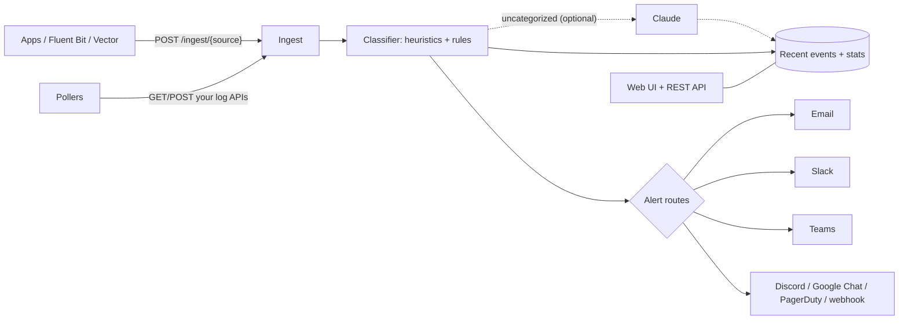

# Laya

Laya reads logs, classifies them, and alerts the right people. It runs as a single small Go service with a built-in web UI, and ships with a Nomad job for deployment.

- **Ingest two ways.** Senders POST logs to Laya's ingest endpoint (push), or Laya polls your HTTP APIs for logs (pull). JSON, JSON arrays, NDJSON and plain text are all accepted.
- **Analyze log files.** Upload a log file on the **Log files** page (or with curl, or `laya analyze` in a terminal) to get a classified report: a timeline in the file's own time, top issues, the alert routes that would have fired, and searchable events. Analysis never touches live events or sends alerts.
- **Classify.** Every event gets a severity, a category and tags. Built-in detection reads level fields and common log formats; an ordered rule engine that you edit in the UI does the rest. Repeats of the same problem are grouped by fingerprint.
- **Notify.** Routes send matching events to pluggable notifiers: email (SMTP), Slack, Microsoft Teams, Discord, Google Chat, PagerDuty, or any HTTP endpoint through a templated webhook. Per-problem throttling keeps channels quiet.
- **Optional AI classification.** Events the rules can't categorize can be sent to Claude for a category, severity and one-line summary. Off by default, budgeted per hour, and cached per fingerprint.



## Quick start

```sh
# Run locally (Go 1.24+)
LAYA_ADMIN_TOKEN=change-me-to-something-long make run
# → http://localhost:8080, sign in with the token

# or with Docker
docker build -t laya .
docker run -p 8080:8080 -e LAYA_ADMIN_TOKEN=change-me-to-something-long -v laya-data:/data laya
```

A fresh install has one push source called `default`. Open **Sources → Setup instructions** to copy its ingest URL and token, then send something:

```sh
curl -X POST http://localhost:8080/ingest/default \
  -H "Authorization: Bearer <ingest token>" \
  -H "Content-Type: application/json" \
  -d '{"level":"error","service":"checkout","message":"payment failed: connection refused to db:5432"}'
```

It appears on **Events** classified as `error / network`. Add a notifier under **Notifiers**, use **Send test** to check it, then create an **Alert route** to connect them.

To deploy on Nomad, see [deploy/nomad/README.md](deploy/nomad/README.md).

## Concepts

### Sources

| Type | How it works |
| --- | --- |
| **push** | Laya serves `POST /ingest/{source id or name}`. Authenticate with `Authorization: Bearer <token>`, an `X-Laya-Token` header, or `?token=`. Bodies may be gzip-encoded. Each source has its own token, which you can rotate. |
| **pull** | Laya calls your endpoint on an interval with optional bearer, basic or custom-header auth, extra headers and a POST body. `{since_rfc3339}`, `{since_unix}`, `{since_unix_ms}`, `{now_rfc3339}`, `{now_unix}` and `{now_unix_ms}` in the URL or body are replaced on every poll ("since" is the previous successful poll), and records already seen can be skipped. **Test fetch** in the editor previews parsed and classified records before you save. |

Parsing is shared by both. Laya finds the message, level and timestamp automatically (`message`/`msg`/`log`/`MESSAGE`…, `level`/`severity`/`PRIORITY`…, `@timestamp`/`timestamp`/`time`/`ts`…, including epoch seconds, milliseconds, microseconds and nanoseconds), unwraps common envelopes (`records`, `logs`, `events`, `data`, `items`, `results`, Elasticsearch `hits.hits[]._source`), and folds indented stack-trace lines into the preceding plain-text line. You can override any of these per source, including a dot-path to the records array (e.g. `data.items`).

### Log files (manual analysis)

Open **Log files**, drop one or more files, and Laya parses and classifies them with your current rules. Each file gets a report:

- lines, events, errors, and the time span the file covers;
- a timeline in the file's own time;
- counts by category and by matched rule;
- the alert routes that would have fired, and roughly how many alerts that would have meant (nothing is actually sent);
- top issues (patterns), plus an **Uncategorized patterns** list with a **Create rule** shortcut;
- searchable, filterable events with line numbers.

You can download the report (JSON) and the events (NDJSON), and re-run a file after changing rules.

What it understands:

| | |
| --- | --- |
| Formats | Plain text, NDJSON, JSON (arrays, back-to-back objects, and exports that wrap records such as Elasticsearch `hits.hits`, CloudTrail `Records`, or `data`/`events`/`logs`), and CSV with a header row (`.csv`; e.g. Kibana or CloudWatch Insights exports). JSON is streamed one record at a time, so exports of any size work. |
| Multi-line records | Java/logback stack traces including unindented `Caused by:` and exception headers, Python tracebacks, Go panics. When most lines start with a timestamp, a record runs until the next timestamped line; otherwise, indented lines join the line above. |
| Timestamps | ISO 8601 / RFC 3339, `2026/10/11 10:15:02` (nginx, Go), syslog `Oct 11 10:15:02` (the year is inferred), Apache `[Mon Oct 11 …]`, access-log `[11/Oct/2026:10:15:02 +0000]`, klog, and RFC 5424, plus JSON/CSV timestamp fields and epoch numbers. Pick a time zone for timestamps that don't carry one. A record without a timestamp inherits the previous record's (marked "≈" in the UI). |
| Encodings | UTF-8 (with or without BOM), UTF-16 from Windows/PowerShell, gzip. The NUL padding left by logrotate's `copytruncate` is skipped. Archives (zip, tar, xz, …) and binary files are refused with a clear message. |

Choose **Parse as** a source to apply that source's parsing settings and tags. This also makes fingerprints match the source's live events.

**Limits.** Uploads are capped at `LAYA_MAX_IMPORT_BYTES` (100 MB by default; gzip shrinks logs 5–30×), and decompressed content at 512 MB per file. One file is analyzed at a time. Analysis pauses whenever live ingest is backed up, so it never crowds out live logs. A file that hits a limit, the 45-minute time limit, or malformed data part-way through still gets a report covering everything read before the stop. The report says it is partial and why.

**Memory.** Every event is counted in the report, but only a sample is kept to browse: up to 5,000 events or 16 MB per file, preferring the most severe events plus a few examples of every pattern. The last 5 reports are kept in memory, and browsable events across them share `LAYA_IMPORT_MEMORY_MB` (64 MB), oldest freed first. Reports are cleared when Laya restarts. Download anything you want to keep.

Throughput with the default rules is roughly 20–30k lines per second on one core (measured on a mixed Java application log); `laya analyze` uses all cores.

**From a terminal.** The same analysis runs offline with no size limits, using all CPU cores:

```sh
laya analyze app.log                         # summary: severities, categories, top issues, routes
laya analyze -tz Europe/Berlin -source api app.log.gz app.log.1
laya analyze -output json app.log | jq .     # one full report per file
laya analyze -output ndjson -min-severity error app.log > errors.ndjson
laya analyze -fail-on critical deploy.log    # exit status 2 if anything critical (CI)
docker run --rm -i ghcr.io/vipinmohan22/laya analyze - < app.log
```

Rules come from `-config`, else `$LAYA_CONFIG`, else `$LAYA_DATA_DIR/config.json`, else the built-in defaults. A config exported from **Settings → Backup** works, so you can analyze locally with your team's rules. `laya analyze` uses only rules, sources and route filters. It never builds notifiers or calls the AI API, so it makes no network calls.

**Over HTTP:**

```sh
curl -H "Authorization: Bearer $LAYA_ADMIN_TOKEN" -F file=@app.log https://laya.example.com/api/imports
curl -H "Authorization: Bearer $LAYA_ADMIN_TOKEN" --data-binary @app.log.gz \
  "https://laya.example.com/api/imports?name=app.log.gz&source=<source id>&tz=UTC&format=auto"
```

The response is the finished report. `GET /api/imports/{id}/events` (and `?format=ndjson`), `/patterns` and `/events/{eventId}` return the details.

### Classification

1. **Severity detection.** Laya reads explicit level fields (names, syslog 0–7, pino/bunyan 10–60), klog prefixes (`E1011 …`), `level=` key/values and leading level tokens, then falls back to keywords such as panic/fatal, error/exception/failed, and warn/deprecated.
2. **Rules, top to bottom.** Conditions test `message`, `level`, `severity`, `source`, `category`, `tags`, or any structured field by dot path (`http.status_code`). The operators are contains, equals, starts/ends with, regex (RE2, so no catastrophic backtracking), exists/missing, and numeric `>`/`<`, each with a negated form where it makes sense. Every matching rule adds tags and can set the severity or raise it to a minimum. The first matching rule with a category decides the category. **Drop** discards the event and **Stop** ends evaluation. Rules can be limited to specific sources.
3. **Fingerprint.** The message is reduced to a pattern (numbers, IPs, UUIDs, hex ids and timestamps replaced by placeholders) and hashed with the source. The fingerprint groups the dashboard's "Top issues" and drives notification throttling and the AI cache.

Laya ships with editable default rules for crashes and panics, resource exhaustion, security attacks, auth failures, HTTP 5xx, database, network, slow operations, exceptions and deployments. The **Rule tester** runs a pasted sample through the rules without storing it, and the rule editor can test a draft rule on its own.

### Notifiers and routes

A **route** selects events by minimum severity, categories, sources, tags and an optional message regex, and sends them to one or more **notifiers**. With throttling on, after alerting on a problem the route suppresses the same fingerprint on that notifier for the window you choose. The next alert says how many similar events were suppressed. Deliveries are retried on network errors, 429s and 5xx responses (3 attempts with backoff), and every attempt appears under **Deliveries**.

| Notifier | Notes |
| --- | --- |
| Email (SMTP) | STARTTLS, implicit TLS or plaintext. HTML and plain-text bodies. Multiple recipients. |
| Slack | Incoming webhook with colour-coded blocks and an optional mention on critical events. Also works with Mattermost and Rocket.Chat. |
| Microsoft Teams | Adaptive Card. Works with Teams Workflows ("Post to a channel when a webhook request is received") and legacy incoming webhooks. |
| Discord | Embed, with mentions disabled so log text can't ping `@everyone`. |
| Google Chat | Space webhook. |
| PagerDuty | Events API v2. The fingerprint is the dedup key, so repeats update one incident. |
| Generic webhook | Any method, URL and headers. The body is a Go `text/template` (`{{ json .Title }}`, `.Event.Severity`, `.Event.Fields`, `.Link`, …). Leave it empty for Laya's standard JSON payload. Use it for Opsgenie, ntfy, Zulip, internal services and so on. |

**Secrets.** Any setting, as well as pull-source credentials and headers, can be written as `${env:NAME}`. Laya reads the value from its environment at send time, so secrets can live in Nomad Variables or Vault rather than Laya's config file. Secret fields are masked in the API and UI, and saving a form with the masked value unchanged keeps the stored secret.

**Adding a notifier type.** Create a file in `internal/notify/` that calls `Register(&Plugin{...})` from `init()`, declaring its fields (label, type, required, secret, help) and a constructor that returns a `Sender`. The UI renders the form from that schema and nothing else needs to change. See `chat.go` for compact examples.

### AI classification (optional)

Under **Settings → AI classification**, enable it and set the API key, preferably as `${env:ANTHROPIC_API_KEY}` backed by a Nomad Variable. By default only events at or above *warning* that no rule categorized are sent. Claude picks a category from your category list, a severity and a short summary, using structured JSON output constrained to those values. The defaults are `claude-opus-5-5` at `low` effort; Sonnet 5.5 and Haiku 5.5 are selectable for lower cost. Server-side refusal fallbacks are enabled on models that support them.

- Rules stay authoritative. AI only fills in a missing category, and only overrides severity when neither the log record nor a rule set one.
- Results are cached per fingerprint for 24 hours, so a recurring error costs one call.
- **Max calls per hour** caps spend. Authentication errors pause calls for 30 minutes, and rate limits or 5xx responses pause them for 2 minutes.
- Log content is passed as untrusted data, and the model is told not to follow instructions inside it.

## Configuration

Runtime configuration (sources, rules, notifiers, routes, settings) is edited in the UI and stored in `$LAYA_DATA_DIR/config.json`, which is written atomically with mode 0600. **Settings → Backup** exports and imports it as JSON.

| Environment variable | Default | Purpose |
| --- | --- | --- |
| `LAYA_ADMIN_TOKEN` | random per run (logged) | Bearer token for the UI and API. Set it to a long random value. |
| `LAYA_LISTEN` | `:8080` | HTTP listen address. |
| `LAYA_DATA_DIR` | `./data` | Where `config.json` lives. |
| `LAYA_PUBLIC_URL` | derived from requests | External URL for ingest instructions and notification links (the UI setting takes precedence). |
| `LAYA_CONFIG_SEED` | — | JSON config file used on first start only, when `config.json` doesn't exist yet. |
| `LAYA_EVENT_BUFFER` | `5000` | Recent events kept in memory for the UI. |
| `LAYA_QUEUE_SIZE` | `10000` | Pipeline queue. When it's full, ingest returns 503 with `Retry-After`. |
| `LAYA_WORKERS` / `LAYA_AI_WORKERS` / `LAYA_NOTIFY_WORKERS` | `4` / `2` / `4` | Concurrency. |
| `LAYA_MAX_INGEST_BYTES` | `10485760` | Maximum request body (compressed). Decompressed bodies may be up to 4× this. |
| `LAYA_MAX_IMPORT_BYTES` | `104857600` | Largest log file upload on the Log files page (as sent, so possibly gzipped). |
| `LAYA_IMPORT_MEMORY_MB` | `64` | Memory for browsable events across kept log file analyses. |
| `LAYA_LOG_LEVEL` / `LAYA_LOG_FORMAT` | `info` / `json` | Laya's own logs (`text` for humans). |

Endpoints outside the UI:

- `GET /healthz` returns liveness (used by the Nomad check).
- `GET /metrics` serves Prometheus metrics: events received, processed, dropped and rejected; queue depths; last-hour events by severity; notification outcomes; AI calls; pull-source health.
- `POST /ingest/{source}` accepts logs.
- `POST /api/imports` analyzes a log file (admin token required, like the rest of `/api/*`).
- `/api/*` is the REST API the UI uses. Everything requires `Authorization: Bearer $LAYA_ADMIN_TOKEN`.

## Operational notes

- **Single instance.** Configuration is one file on one volume, so the Nomad job runs `count = 1` and Nomad reschedules it if the node fails. Recent events and delivery history live in memory and reset on restart. Laya is a classifier and alerter, not long-term log storage; keep shipping logs to your log store as well (a webhook notifier can forward classified events).
- **Security.** The UI sends a strict Content-Security-Policy and renders all log content as text, never HTML. Ingest and admin tokens are compared in constant time. Pull sources and webhooks can reach any URL the admin enters, so treat the admin token like infrastructure credentials and put Laya behind TLS (for example Traefik or another load balancer).

## Development

```sh
make test            # go test -race ./...
make lint            # gofmt, go vet, JS syntax check
make build           # bin/laya
make docker          # container image
make nomad-validate  # nomad fmt -check + job validate
```

The layout:

```
cmd/laya            entrypoint, env configuration, `laya analyze`
internal/config     config model, validation, JSON store, secret masking
internal/ingest     payload parsing (JSON / NDJSON / text / CSV), streaming file reader
internal/poller     pull-source polling
internal/classify   severity heuristics, rule engine, fingerprints
internal/ai         optional Claude classifier
internal/pipeline   queue → classify → (AI) → store → dispatch
internal/importer   log file analysis: reports, retention, timeline
internal/events     in-memory recent events and stats
internal/notify     notifier plugins, routing, throttling, retries
internal/server     REST API, ingest endpoint, metrics, UI hosting
web/static          the UI (plain JS, no build step)
deploy/nomad        Nomad job, volume and variables
```
